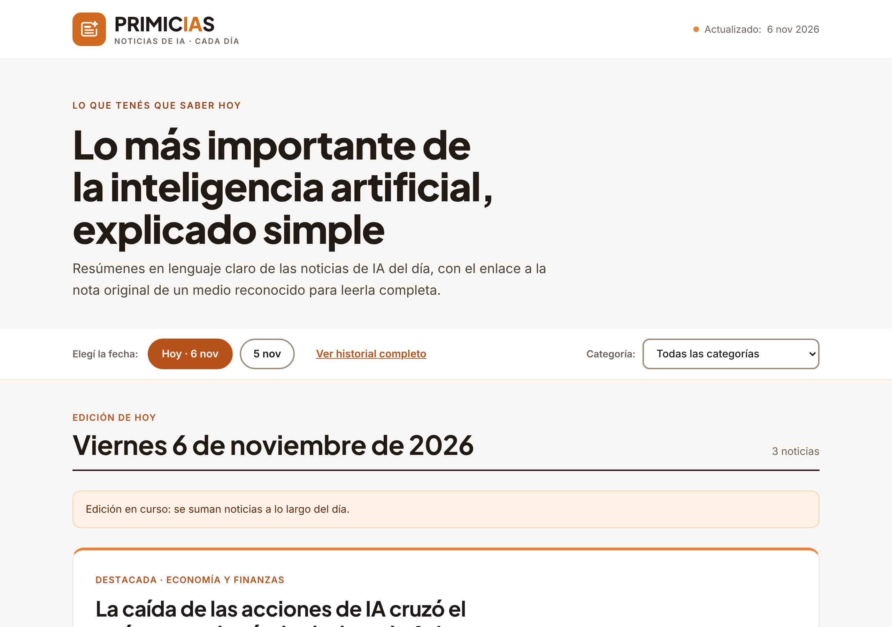
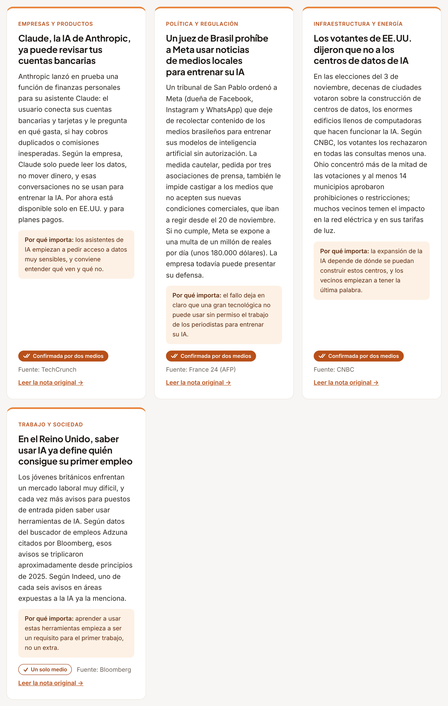
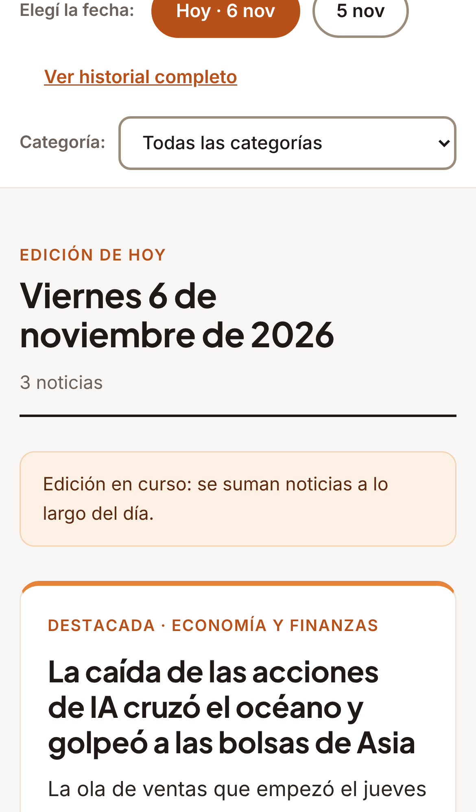

# Primicias IA

**Las noticias de inteligencia artificial del día, explicadas en lenguaje simple y con fuentes verificadas.**

Primicias IA es un resumen diario de noticias de IA pensado para personas **no técnicas**. Cada día reúne las noticias más relevantes de medios reconocidos, las explica sin jerga, cuenta por qué le importan a un lector común y marca con claridad cuánto está confirmada cada una. Todo el proceso de búsqueda, verificación, redacción y publicación está automatizado con IA (Claude) y se ejecuta tres veces por día.

🔗 **Demo en vivo:** `https://YESICATORRICO.github.io/primicias-ia/` 



---

## El problema

Las noticias sobre IA salen a toda velocidad, están llenas de términos técnicos y mezclan anuncios de empresas con información verificada. Una persona que no trabaja en tecnología no tiene tiempo de leer diez medios en inglés ni forma fácil de saber qué tan confiable es cada titular.

## La solución

- **Un resumen diario** con entre 2 y 6 noticias nuevas por actualización, organizadas por fecha.
- **Lenguaje claro**: cada noticia tiene un resumen de 2 a 4 oraciones que explica los términos técnicos y un "Por qué importa" pensado para el lector común.
- **Solo fuentes autorizadas**: 23 medios (agencias, diarios internacionales, sitios de tecnología y medios en español) más fuentes oficiales. Siempre se enlaza la nota original.
- **Marcas de verificación** visibles en cada noticia (ver abajo).
- **Navegación simple**: selector por fecha, historial de ediciones y filtro por 9 categorías (Política y regulación, Economía y finanzas, Seguridad y privacidad, Educación, etc.).
- **Diseño responsive** y accesible: funciona en el celular, con contraste suficiente y botones de tamaño táctil.

## Sistema de verificación ✓✓ / ✓

Una de las decisiones de diseño centrales del proyecto. En lugar de descartar las noticias que solo publicó un medio, se publican con una marca distinta, así el lector decide con información:

| Marca | Significa |
|---|---|
| **✓✓ Confirmada por dos medios** | Otro medio de la lista o una fuente oficial involucrada contó lo mismo con **redacción propia** (no valen dos copias del mismo cable de agencia ni notas que solo citan a la primera). |
| **✓ Un solo medio** | La publicó un medio autorizado, pero todavía no hay una segunda cobertura que la confirme. Si aparece durante el día, pasa a ✓✓. |

Reglas adicionales: la noticia destacada siempre es ✓✓, hay un máximo de 2 noticias ✓ por día y las cifras que aporta una empresa sobre sí misma se aclaran en el resumen. Detalle completo en [docs/criterios-editoriales.md](docs/criterios-editoriales.md) y en el [PDF de fuentes autorizadas](docs/Primicias-fuentes-autorizadas.pdf).



## Cómo funciona la automatización

```
 Tarea programada (3 veces por día, hora de Argentina)
        │
        ▼
 1. Lee las noticias ya publicadas (para no repetir)
 2. Busca noticias de IA del día en varias temáticas
 3. Filtra: solo fuentes autorizadas
 4. Verifica: busca una segunda cobertura independiente → ✓✓ o ✓
 5. Redacta: titular propio, resumen simple, "por qué importa", categoría
 6. Actualiza solo el bloque de datos (el diseño no se toca)
 7. Valida el JavaScript y publica
 8. Registra las noticias que quedaron afuera y por qué
        │
        ▼
 En la corrida de la noche: cierra la edición y agrega "En 30 segundos",
 con 2 o 3 datos clave del día
```

Las instrucciones completas que recibe la IA en cada corrida están en [automatizacion/prompt-tarea-programada.md](automatizacion/prompt-tarea-programada.md). Es la pieza más importante del proyecto: convierte criterios editoriales en reglas concretas y verificables.

**Separación entre diseño y datos:** la automatización solo puede modificar el archivo de datos ([data/ediciones.js](data/ediciones.js)). Así el diseño se mantiene estable y cada actualización es un cambio chico y fácil de revisar.

## Estructura del repositorio

```
primicias-ia/
├── index.html                      # La página (HTML + CSS + JS, sin dependencias)
├── data/
│   └── ediciones.js                # Ediciones y noticias (lo único que cambia cada día)
├── automatizacion/
│   └── prompt-tarea-programada.md  # Instrucciones de la tarea programada
└── docs/
    ├── criterios-editoriales.md    # Fuentes autorizadas y reglas de verificación
    ├── Primicias-fuentes-autorizadas.pdf
    └── img/                        # Capturas de pantalla
```

### Formato de una noticia

```js
{
  featured: false,          // true solo para la destacada del día
  verified: true,           // true = ✓✓ confirmada · false = ✓ un solo medio
  category: "Seguridad y privacidad",
  title: "Titular propio y claro",
  summary: "2 a 4 oraciones en lenguaje simple.",
  why: "por qué le importa a un lector común.",
  source: "Nombre del medio",
  url: "https://nota-original..."
}
```

## Verlo localmente

No hace falta instalar nada: descargá el repositorio y abrí `index.html` en el navegador.

## En el celular



## Herramientas

- **Claude (Cowork)**: búsqueda web, verificación, redacción y publicación mediante una tarea programada.
- **HTML, CSS y JavaScript** sin frameworks.
- Tipografías **Plus Jakarta Sans** e **Inter** (Google Fonts).

## Lo que aprendí

- **Escribir reglas editoriales para una IA obliga a definirlas con precisión.** "Contrastada con otra fuente" no alcanzaba: hubo que definir qué cuenta como fuente independiente (otra empresa periodística, con redacción propia, sin copias de cable).
- **La transparencia es mejor que el descarte.** Publicar con ✓ las noticias de un solo medio, en vez de esconderlas, le da más información al lector sin bajar el estándar.
- **Separar datos y diseño** hace que la automatización sea más segura y predecible.


---

*Los resúmenes son de elaboración propia y cada noticia enlaza a su fuente original; los derechos sobre las notas pertenecen a cada medio. El código de la página está disponible bajo licencia MIT.*
